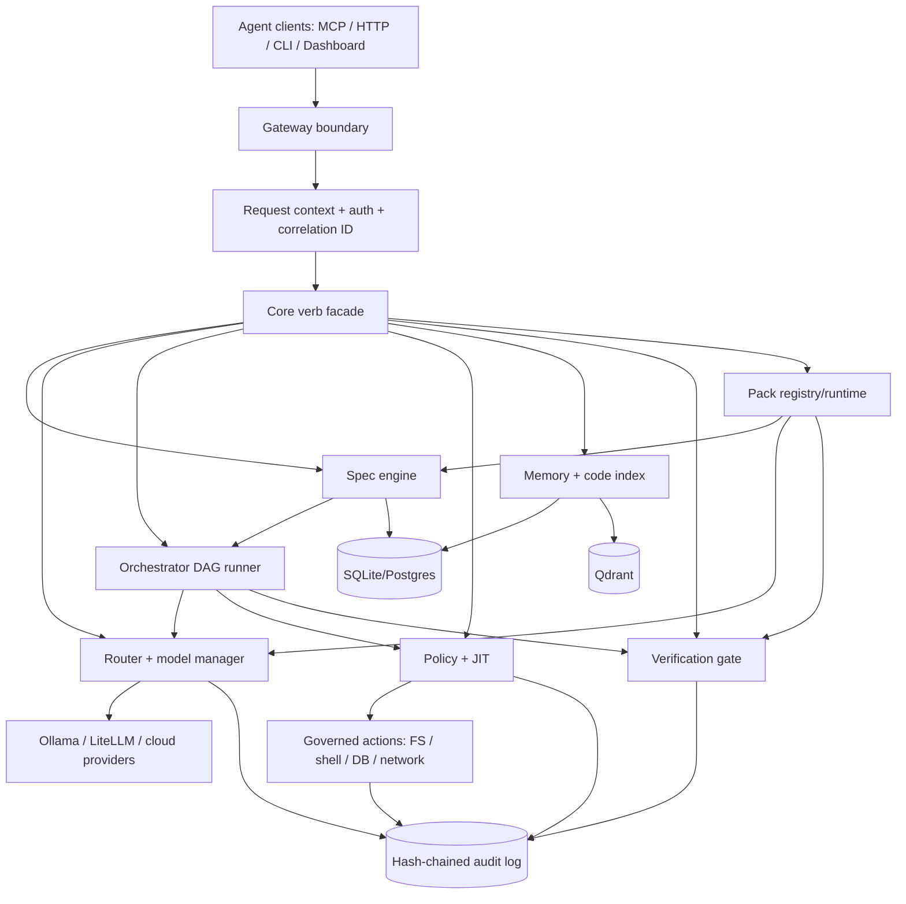
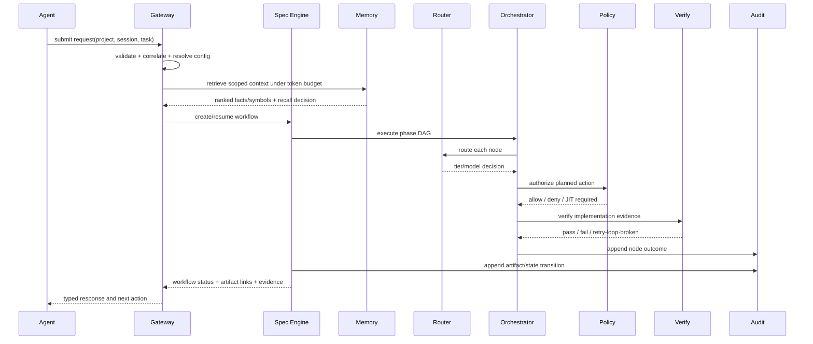
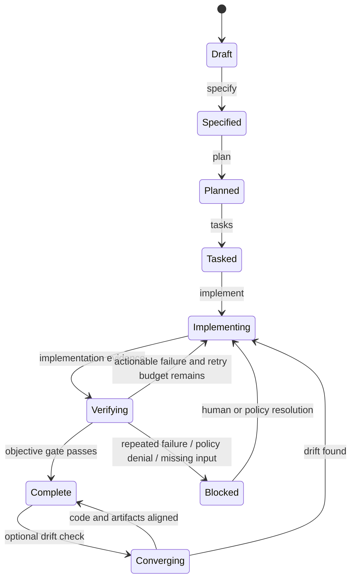

# PromptWise Agentic OS — Implementation Analysis

**Review date:** 2026-09-04  
**Scope:** repository code, project documents, tests, configuration, and delivery plan  
**Status:** implementation-readiness assessment; no production code changed

## Executive assessment

PromptWise has a coherent product thesis and a credible Phase 0–4 foundation: a local-first router, objective verification gate, default-deny policy engine, tamper-evident audit log, memory/code-context primitives, and a fail-soft DAG runner. The repository is best understood as a well-tested core-engine slice rather than an end-to-end control plane.

The next critical increment is Phase 5.2: a persisted, spec-driven workflow engine that turns a request into traceable artifacts and invokes the existing DAG runner and verification gate. Before implementing it, close the persistence and orchestration seams, define the artifact/state contract, and expose the core verbs through a stable gateway/MCP surface. The dashboard, desktop app, and reference packs should consume that contract rather than introduce parallel business logic.

## Product vision distilled

The product is an agent-agnostic control plane underneath MCP-capable coding agents. Its differentiators are:

1. Local-first, privacy-aware model routing and cost control.
2. Objective verification before a task is considered complete.
3. Policy-gated and audited system actions, with reversible writes and JIT permissions.
4. Persistent, scope-aware memory and code intelligence.
5. Spec-driven workflows with artifacts that can be checked against implementation.
6. Installable packs that contain domain knowledge without contaminating the generic core.
7. Self-diagnosis and supportability from the first install.

The architectural invariant is: **interfaces call core verbs; core verbs use governed infrastructure; packs contribute declarative knowledge and call core verbs; no domain logic moves into `core/` or `gateway/`.**

## Evidence-based current state

### Implemented

- `core/routing/`: catalog-driven tier selection, local-only/privacy routing, RAM fallback, cost calculation.
- `core/verify/`: tests, lint, Semgrep, Gitleaks, blocking decision, identical-failure ledger.
- `core/policy/`, `core/actions/`, `core/audit/`: default-deny rules, JIT support, governed `fs_write`, undo buffer, hash-chain audit.
- `core/index/`: incremental tree-sitter symbol indexing for Python/JS/TS/TSX backed by SQLite.
- `core/memory/`: SQLite/FTS5 facts, optional Ollama embeddings, Qdrant vectors, RRF retrieval, PII flagging.
- `core/ingestion/`: explicit sweep that refreshes code index and records supplied session text.
- `core/orchestrate/`: topological validation and sequential fail-soft DAG execution with per-node routing hints and audit events.
- `core/packs/`: manifest/schema/semver validation and install/list/remove foundation.
- `gateway/`: FastAPI health, diagnostics, route, cost-report, and verify endpoints; in-process MCP currently exposes `verify_output`.
- `compose/`: Ollama, Qdrant, and gateway containers bound to loopback by default.

### Not implemented or materially incomplete

- No `specify → plan → tasks → implement → verify` spec engine or artifact persistence.
- No SQLAlchemy/Alembic models or migrations despite the locked stack declaration.
- No dashboard source; `dashboard/` contains only agent instructions. No `desktop/` directory exists.
- `packs/registry/` has no reference packs; no declarative pack DAG/tool loading or hot-reload registry exists.
- Most core verbs are not exposed through HTTP or MCP: orchestration, policy, memory, code index, ingestion, packs, and audit queries have no stable external adapter.
- No CI workflow is present, so the documented test count is not independently enforced.
- Doctor still returns intentional WARN stubs for Ollama and Qdrant health.
- MCP protocol-version compatibility with the target 2026 revision is not verified in repository code/tests.

## Findings and gaps

Severity uses: **P0** blocks the next phase or violates a non-negotiable goal; **P1** should be fixed before broad exposure; **P2** is correctness/operability debt; **P3** is polish or future scale.

| ID | Severity | Finding | Impact | Recommended action |
|---|---|---|---|---|
| F-01 | P0 | Spec engine has no implementation, storage, or artifact contract. | Phase 5 acceptance cannot be met; no durable workflow state or traceability. | Design `Workflow`, `Artifact`, `Task`, `Attempt`, and `Verification` records; implement graduated ceremony and converge/diff. |
| F-02 | P0 | Locked SQLAlchemy/Alembic stack is absent. | Spec persistence will otherwise create a second storage model and migration dead end. | Add SQLAlchemy 2 models and Alembic migrations before or with the spec engine; retain SQLite default and Postgres-compatible types. |
| F-03 | P0 | `orchestrate_tasks` calls `route_request` outside its per-node `try`. | A routing `ValueError` can abort a partially executed DAG, violating fail-soft behavior. | Move routing into the node try and return a node-level error; cache hardware/catalog per invocation. |
| F-04 | P1 | Gateway/MCP surface is far behind the core contract. | Agents cannot use most implemented capabilities; dashboard has no stable API to consume. | Publish versioned adapters for core verbs, with request IDs, session/project scope, error envelopes, and auth/binding policy. |
| F-05 | P1 | Mandatory governance is uneven. | Indexing, memory, verification shell-outs, pack install/remove, and undo are not consistently policy-checked/audited. | Define an action taxonomy and enforcement boundary; audit every external side effect and sensitive read, including outcome and actor. |
| F-06 | P1 | Session memory accepts `session_id` but query does not filter on it. | Cross-session facts can leak into a session-scoped result. | Add session predicate to SQLite and Qdrant paths and require an explicit session context at adapters. |
| F-07 | P1 | Memory recall is not audited on the normal path. | The system cannot explain why a fact was recalled, weakening the memory differentiator and forensic trail. | Emit a recall decision with candidate IDs, selected IDs, scope, PII exclusions, and ranking mode. |
| F-08 | P1 | Active environment cannot collect the full suite. | CI/release confidence is currently unverified; missing dependencies are detected only at test collection. | Add/validate install workflow from `pyproject.toml`, pin compatible versions, add CI matrix, and run the full suite in a clean environment. |
| F-09 | P2 | `query_code_index` uses an unescaped `LIKE` pattern. | `_` and `%` over-match symbols, reducing query precision. | Escape LIKE metacharacters and add `ESCAPE '\'`; add regression tests. |
| F-10 | P2 | Code index keys are not normalized/scoped by root. | Relative/absolute roots can duplicate indexes; stale cleanup can be unsafe with shared stores. | Normalize root and file keys; include root identity in index storage or isolate DB per project. |
| F-11 | P2 | Fallback fact hydration is duplicated and lacks defense-in-depth scope predicates. | Schema changes can silently corrupt hydration; vector IDs are trusted too broadly. | Centralize row hydration and constrain fallback lookup by scope/root/session. |
| F-12 | P2 | Doctor's dependency health is incomplete. | A clean install can report broadly healthy while core model/vector services are unreachable. | Implement Ollama/Qdrant checks with bounded timeouts, actionable remediation, and WARN/FAIL policy. |
| F-13 | P2 | Pack capability declarations are parsed but not actor/pack-scoped in policy. | Enabling a pack cannot yet safely grant least privilege without widening permissions globally. | Design actor/pack identity and capability-to-action mapping before reference packs ship. |
| F-14 | P2 | Pack dependencies are presence-only. | Incompatible versions or install order can produce runtime failures as registry grows. | Add version ranges, dependency graph validation, and deterministic install plans. |
| F-15 | P2 | No dashboard or desktop implementation exists. | Phase 6/6.5 are substantial greenfield efforts, not incremental UI work. | Define API contract and event model now; scaffold dashboard after spec API stabilizes; defer Tauri packaging until browser flow is proven. |
| F-16 | P3 | DAG execution is sequential even when branches are independent. | Wide workflows may underuse available local/cloud capacity. | Keep deterministic sequential mode for v1; add bounded concurrency only after profiling and explicit resource/policy semantics. |

## Target architecture

### Component responsibilities

| Component | Owns | Must not own |
|---|---|---|
| Gateway boundary | Protocol adaptation, validation, auth/binding, correlation, response envelopes | Business rules, direct DB writes, domain prompts |
| Context/session service | Project/session identity, context limits, PII/cloud eligibility | Model-specific prompt logic |
| Spec engine | Workflow state machine, artifact versions, acceptance criteria, convergence | Language/framework conventions |
| Orchestrator | DAG validation/execution, dependency status, retries, node telemetry | LLM implementation policy or pack-specific rules |
| Router/model manager | Tier eligibility, privacy, hardware/load state, cost decision | Workflow semantics |
| Policy/action layer | Action authorization, JIT, sandboxing, undo, audit | Pack trust assumptions |
| Verification gate | Objective checks, failure ledger, evidence, final gate | “Trust me” LLM approval |
| Memory/index | Facts, embeddings, symbol locations, scoped retrieval | Unbounded transcript retention |
| Pack runtime | Manifest validation, content discovery, pack-scoped capabilities | Bypassing core verbs or direct system access |
| Persistence | Durable entities, migrations, transaction boundaries | Hidden per-module schemas |

## Primary request flow

## Spec-engine state model

### Spec-engine design decisions

- Use a graduated ceremony: trivial changes may use a lightweight task/evidence record; multi-file or risky changes require full specification, plan, tasks, and convergence.
- Store artifacts as immutable versions with a current pointer. Never overwrite the evidence that led to a decision.
- Make transitions explicit and idempotent. A retried request must resume a known state, not create duplicate work silently.
- Treat `verify_output` as the completion authority. A model self-critique may add advisory evidence but cannot replace objective checks.
- Include a converge step that compares declared requirements/plan/tasks with repository evidence and reports drift.
- Use one correlation ID across gateway request, model decision, policy decision, action, verification run, artifact, and audit records.

## Persistence proposal

Start with SQLAlchemy 2.0 models that are valid for SQLite and PostgreSQL:

- `projects(id, root, config_fingerprint, created_at)`
- `sessions(id, project_id, actor, created_at, last_seen_at)`
- `workflows(id, project_id, session_id, kind, state, risk, created_at, updated_at)`
- `artifacts(id, workflow_id, kind, version, content, content_hash, created_at)`
- `requirements(id, workflow_id, artifact_id, ears_text, priority, status)`
- `tasks(id, workflow_id, parent_id, ordinal, status, dependencies_json)`
- `attempts(id, task_id, route_id, tier, started_at, ended_at, status, cost_usd)`
- `verifications(id, workflow_id, task_id, result, evidence_json, created_at)`
- `memory_recall_events(id, session_id, query_hash, scope, candidate_ids_json, selected_ids_json, created_at)`

Keep large logs and generated files in append-only files/object storage referenced by hash if they outgrow relational rows. Every state mutation should occur in a transaction and emit an audit event after the durable write succeeds.

## API and integration contract

Version the external surface under `/api/v1` and expose the same semantic operations over MCP. Minimum first tranche:

1. `POST /workflows` and `GET /workflows/{id}`.
2. `POST /workflows/{id}/specify`, `/plan`, `/tasks`, `/implement`, `/verify`, `/converge`.
3. `POST /memory/query`, `POST /memory/record`, `POST /index/query`.
4. `POST /orchestrate`, `POST /policy/check`, `GET /audit`.
5. `GET /packs`, `POST /packs/{name}/install`, `DELETE /packs/{name}`.
6. `GET /events` only after the MCP/transport version decision is verified; prefer a gateway-owned event stream with replayable cursors over assumptions about server-initiated MCP streaming.

Every response should include `request_id`, `workflow_id` when applicable, `status`, typed error code, and audit reference. Bind project root/session explicitly; never infer a target project from gateway process cwd for remote calls.

## Non-functional requirements

| Area | Requirement | Verification |
|---|---|---|
| Safety | Default deny for unrecognized actions; no pack bypass; irreversible actions require JIT/human policy. | Policy matrix tests and audit-chain assertions. |
| Auditability | 100% of governed side effects and workflow transitions have correlation-linked audit records. | Instrumentation coverage test + chain verification. |
| Privacy | Local-only routing when configured or PII is present; session/project scopes enforced in lexical and vector retrieval. | Routing and cross-scope leakage tests. |
| Reliability | One node/service failure degrades locally; only malformed workflow structure blocks globally. | Fault-injection tests. |
| Idempotency | Repeated API requests and pack installs converge without duplicate artifacts or unsafe replacement. | Replay tests with same idempotency key. |
| Performance | Gateway health p95 < 200 ms; non-embedding metadata queries p95 < 500 ms on a laptop; bounded model/action timeouts. | CI smoke/performance suite. |
| Cost | Routing decisions and completed-task costs are recorded; cache/context compaction opportunities are observable. | Cost ledger and route decision tests. |
| Operability | Doctor reports dependency reachability, config, policy, audit, pack, and storage health with actionable remediation. | Clean/partial/failing compose fixtures. |
| Portability | SQLite works by default; Postgres migration is configuration-driven; server and desktop share config/pack/artifact formats. | Migration and packaging tests. |
| Supply chain | Pin dependencies/images; validate pack manifests and capabilities; scan generated dependencies. | Lockfile, image, pack, and CI security checks. |

## Recommended implementation sequence

### Stage 0 — unblock and harden the seam

- Add/verify project dependency installation and a CI workflow.
- Fix `orchestrate_tasks` routing exception scope, duplicate IDs, and per-call route caching.
- Fix session filtering, memory audit events, centralized fact hydration, and index LIKE escaping/root normalization.
- Add `.gitignore` entries for regenerable `.promptwise` databases/WAL files and generated hardware state.

### Stage 1 — persistence and workflow contract

- Introduce SQLAlchemy/Alembic baseline and migration test.
- Define Pydantic command/result models and workflow transition rules.
- Implement artifact versioning, idempotency, correlation IDs, and audit-linked transactions.

### Stage 2 — spec engine MVP

- Implement lightweight/full ceremony selection.
- Implement specify, plan, tasks, implement orchestration, verify completion, and converge drift report.
- Reuse `orchestrate_tasks`, `route_request`, `verify_output`, `query_memory`, and `record_audit`; do not duplicate them.
- Add end-to-end fixture: one real feature request, EARS criteria, generated task list, implementation evidence, passing gate.

### Stage 3 — stable external surface

- Add `/api/v1` adapters and MCP tools for workflows, memory, index, orchestration, policy, audit, and packs.
- Add explicit project/session/actor context and typed errors.
- Verify the installed MCP SDK/protocol behavior before designing live event delivery.

### Stage 4 — dashboard and packs

- Build dashboard against the API contract: chat/workflow view, routing/cost badges, audit/policy viewer, diagnostics, Builder/Pro modes.
- Implement reference packs and pack-scoped capability enforcement only after the actor model exists.
- Add a pack contract test suite and a sample intelligence pack.

### Stage 5 — desktop packaging

- After browser/server UX and lifecycle are stable, add Tauri shell and sidecar supervision for gateway/Ollama/Qdrant.
- Reuse the same API, config, pack, artifact, and migration contracts.

## Release gates

Do not call Phase 5 complete until the end-to-end spec fixture passes in a clean environment and every transition is audit-linked. Do not call Phase 6 complete until the dashboard uses only versioned gateway contracts. Do not call Phase 8 complete until pack capabilities are actor-scoped and a malicious/invalid pack cannot widen policy or escape its install root.

## Sources in this repository

- [Vision](VISION.md)
- [Architecture](ARCHITECTURE.md)
- [Roadmap](ROADMAP.md)
- [Backlog](BACKLOG.md)
- [Maintenance](MAINTENANCE.md)
- [Research refresh](research/2026-08-31-findings-refresh.md)
- [Orchestrator design](superpowers/specs/2026-08-24-orchestrate-tasks-design.md)

